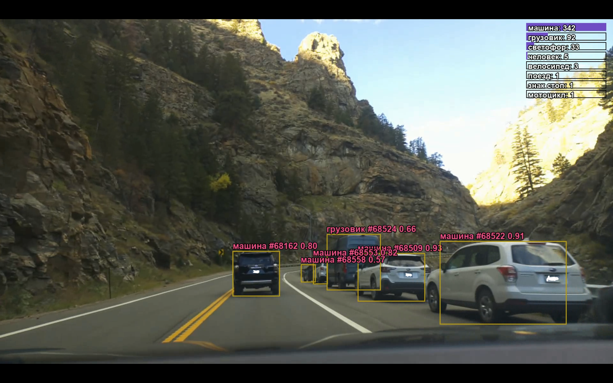

# DriveBy

A Raspberry Pi 5 dashcam that records drives with synced GPS, plus an on-device object-detection mode with a live Russian-language leaderboard overlay.

   

## Scripts

### `record.py` — record-only mode (current)

Lean capture for the car, with no detection on the Pi.

- 1080p30 H.264 in 10-minute chunks (~90 MB/min at 12 Mbps)

- Per-chunk `.json` metadata (start time in local/UTC/monotonic clocks, resolution, bitrate)

- Per-chunk `.gps.jsonl` sidecar read straight from gpsd's JSON socket: lat/lon, altitude, speed, heading, fix mode, error estimate

- GPS timestamps share the same monotonic clock as the video, so a later processing step can line up position with frames

- Auto-reconnects if gpsd drops; closes the current chunk cleanly on Ctrl+C / SIGTERM

Output goes to `~/Videos/DriveRaw/`.

### `DriveBy.py` — on-device detection mode

The original all-in-one version that runs detection live on the Pi.

- YOLOv8n (or a custom model if one is found) runs every 3rd frame at 640x480

- Deduplicates objects across frames using color histograms + bounding-box overlap, so the same car isn't counted twice

- Draws boxes and a live leaderboard (count + confidence bars) with Russian labels for all 80 COCO classes

- Writes MP4 chunks and a per-chunk count summary to `~/Videos/DriveCounts/`

### `gps_test.py`

Quick check that the GPS is producing data.

## Hardware

- Raspberry Pi 5

- Raspberry Pi Camera Module

- USB GPS receiver, served through `gpsd`

- HyperPixel touchscreen (for the live display in `DriveBy.py`)

## Setup

```

sudo apt install python3-picamera2 gpsd gpsd-clients fonts-dejavu-core

```

`DriveBy.py` also needs `ultralytics` and `opencv-python`. It loads them from `~/packages`.

## Usage

```

python3 record.py     # record-only

python3 DriveBy.py    # live detection + overlay (press q to quit)

```

## Annotator (runs on a GPU machine)
The Pi only records. Detection, tracking, and rendering happen afterward on a Windows PC with an NVIDIA GPU, in `annotator/`.

### `process_driveby.bat` — one-click pipeline
Drag a folder of drive chunks onto it, or run it and paste the path. It:
1. Remuxes raw `.h264` chunks to `.mp4` with ffmpeg
2. Runs `detect.py` over the folder
3. Runs `render.py` on every chunk that has detections but no annotated output yet

Every step skips finished work, so it's safe to stop and re-run.

### `detect.py` — GPU detection + tracking
Runs YOLO26l with ByteTrack (pipeline defaults: confidence 0.05, 960px input) and writes a `.bytetrack.jsonl` sidecar per chunk, with one record per detection: frame, class, track ID, confidence, and box. Confidence is kept deliberately low so all filtering happens at render time.

### `render.py` — annotation + counts
Reads a video and its sidecar and produces:
- `.annotated.mp4` with boxes, track IDs, and a live leaderboard (Russian or English labels)
- `.counts.txt` with per-chunk totals

Filtering (confidence floor, minimum track length, class groups like `vehicles` / `road` / `animals`) is applied here, so thresholds can change without re-running the GPU pass. `--drive FOLDER` carries the leaderboard across chunks and writes `drive_totals.txt`. GPS overlay support is in progress.

### Setup
- Python venv with `ultralytics`, `opencv-python`, `pillow`, `numpy` (CUDA build of PyTorch)
- `ffmpeg` on PATH
- The pipeline expects the venv at `%USERPROFILE%\driveby-env`. Edit `PY=` in the `.bat` if yours is elsewhere.

## Privacy

Recordings and GPS logs contain location data. They're saved outside this folder and excluded by `.gitignore`.

