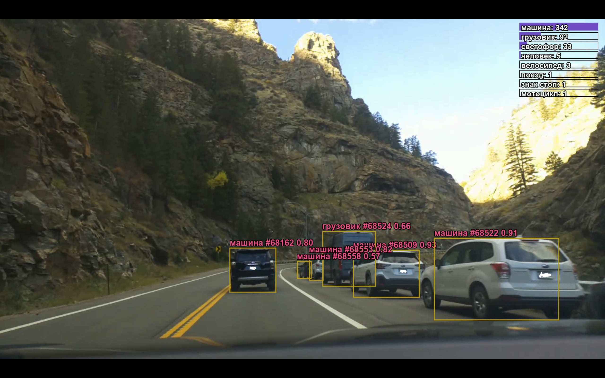

# DriveBy

A Raspberry Pi 5 dashcam that records drives with synced GPS and cabin audio, plus an on-device object-detection mode with a live Russian-language leaderboard overlay.



## Scripts

### `record.py` — record-only mode (current)

Lean capture for the car, with no detection on the Pi.

- 1080p30 H.264 in 10-minute chunks (~90 MB/min at 12 Mbps)
- Per-chunk `.json` metadata (start time in local/UTC/monotonic clocks, resolution, bitrate)
- Per-chunk `.gps.jsonl` sidecar read straight from the USB GPS dongle's NMEA output: lat/lon, altitude, speed, heading, satellites, HDOP
- NMEA checksums are validated, and the reader reconnects if the dongle drops or goes quiet for 10 s
- GPS timestamps share the same monotonic clock as the video, so a later processing step can line up position with frames
- Closes the current chunk cleanly on Ctrl+C / SIGINT / SIGTERM

Output goes to `~/Videos/DriveRaw/`.

### `driveby_button.py` — on-screen start/stop

A large always-on-top button on the HyperPixel, launched with the desktop.

- Green **DriveBy** when idle; tap to start `record.py` and the audio logger
- Red **STOP** with an elapsed timer while recording; tap to stop both cleanly
- Detects whether `record.py` is already running, so it stays correct if recording is started or stopped over SSH
- Keeps the screen awake only while recording; normal screen blanking applies when idle

### Audio (`pi/audio-log.service`)

A systemd service that records the USB mic with `arecord` (48 kHz mono WAV, 10-minute chunks) to `~/audio_logs/`. It isn't enabled at boot; the button starts and stops it. File names are timestamped for syncing with video.

### `DriveBy.py` — on-device detection mode

The original all-in-one version that runs detection live on the Pi.

- YOLOv8n (or a custom model if one is found) runs every 3rd frame at 640x480
- Deduplicates objects across frames using color histograms + bounding-box overlap, so the same car isn't counted twice
- Draws boxes and a live leaderboard (count + confidence bars) with Russian labels for all 80 COCO classes
- Writes MP4 chunks and a per-chunk count summary to `~/Videos/DriveCounts/`

## Hardware

- Raspberry Pi 5
- Raspberry Pi Camera Module
- USB GPS receiver (u-blox 7), read directly over serial
- USB microphone
- HyperPixel touchscreen

## Pi setup

```
sudo apt install python3-picamera2 python3-serial fonts-dejavu-core
```

gpsd is not used. With the u-blox 7 it switched the receiver to binary mode and froze positions, so `record.py` reads the dongle itself. If gpsd is installed, disable it so it doesn't grab the port:

```
sudo systemctl disable --now gpsd.socket gpsd
sudo systemctl mask gpsd.socket gpsd
```

Audio service, plus permission for the button to start and stop it:

```
sudo cp pi/audio-log.service /etc/systemd/system/
sudo systemctl daemon-reload
echo "$USER ALL=(root) NOPASSWD: /usr/bin/systemctl start audio-log, /usr/bin/systemctl stop audio-log" | sudo tee /etc/sudoers.d/audio-log
sudo chmod 440 /etc/sudoers.d/audio-log
```

Button autostart:

```
mkdir -p ~/.config/autostart
cp pi/driveby-button.desktop ~/.config/autostart/
```

Paths assume the user `debo` and scripts in the home folder; edit `pi/` files and the paths at the top of the scripts if yours differ. The mic's ALSA card name (`Device`) and the GPS device path are also set there.

`DriveBy.py` also needs `ultralytics` and `opencv-python`. It loads them from `~/packages`.

## Usage

Tap the on-screen button, or from a terminal:

```
python3 record.py     # record-only (video + GPS)
python3 DriveBy.py    # live detection + overlay (press q to quit)
```

## Annotator (runs on a GPU machine)
The Pi only records. Detection, tracking, and rendering happen afterward on a Windows PC with an NVIDIA GPU, in `annotator/`.

### `process_driveby.bat` — one-click pipeline
Drag a folder of drive chunks onto it, or run it and paste the path. It:
1. Remuxes raw `.h264` chunks to `.mp4` with ffmpeg
2. Runs `detect.py` over the folder
3. Runs `render.py` on every chunk that has detections but no annotated output yet

Every step skips finished work, so it's safe to stop and re-run.

### `detect.py` — GPU detection + tracking
Runs YOLO26l with ByteTrack (pipeline defaults: confidence 0.05, 960px input) and writes a `.bytetrack.jsonl` sidecar per chunk, with one record per detection: frame, class, track ID, confidence, and box. Confidence is kept deliberately low so all filtering happens at render time.

### `render.py` — annotation + counts
Reads a video and its sidecar and produces:
- `.annotated.mp4` with boxes, track IDs, and a live leaderboard (Russian or English labels)
- `.counts.txt` with per-chunk totals

Filtering (confidence floor, minimum track length, class groups like `vehicles` / `road` / `animals`) is applied here, so thresholds can change without re-running the GPU pass. `--drive FOLDER` carries the leaderboard across chunks and writes `drive_totals.txt`. GPS overlay support is in progress.

### Setup
- Python venv with `ultralytics`, `opencv-python`, `pillow`, `numpy` (CUDA build of PyTorch)
- `ffmpeg` on PATH
- The pipeline expects the venv at `%USERPROFILE%\driveby-env`. Edit `PY=` in the `.bat` if yours is elsewhere.

## Privacy

Recordings, audio, and GPS logs contain location data. They're saved outside this folder and excluded by `.gitignore`.
